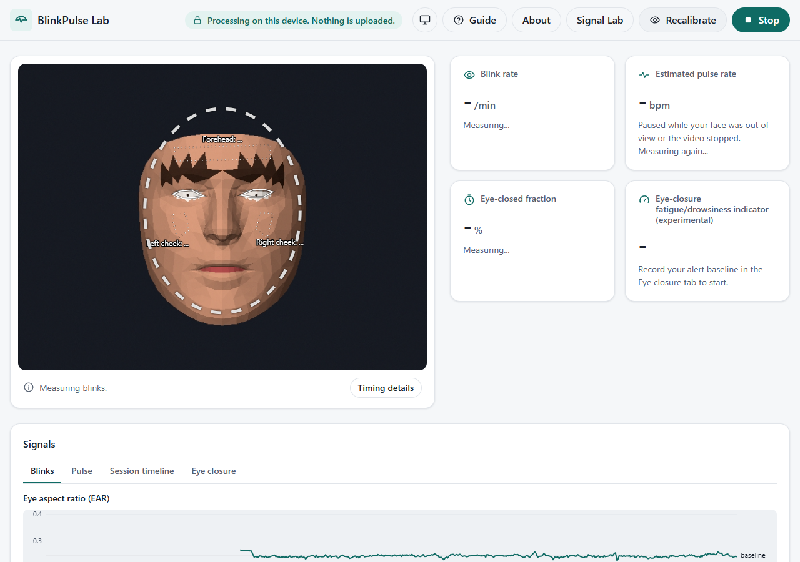

# BlinkPulse Lab

An experimental, fully on-device signal-processing project that estimates **blink metrics** and
**pulse rate** from webcam video, with every key algorithm (FFT, filters, resampling, peak
detection, plots) written by hand and validated against reference data.

> **Status: all features built (Phases 0-5); no validation run yet.** The app tracks face
> landmarks on the device and shows blink rate, eye-closed fraction, a per-minute blink timeline,
> an estimated pulse rate from three skin regions with a quality level, an experimental eye-closure
> indicator, a Signal Lab, and a study mode with its analysis script. None of these has been
> validated on real people yet: validations V1 (blinks), V2 (pulse), and V3 (the indicator study)
> need recordings, a reference device, and participants. The numbers so far come from synthetic
> signals (see `docs/METHODS.md`).

**Live demo:** https://blinkpulse-lab.vercel.app (static hosting; every push to `main` redeploys).
Processing stays on your device there too: after the page and the face model load, the app makes no
network requests.



_Screenshots use a synthetic face rendered from MediaPipe's canonical face model, never a real
person. More in `docs/screenshots/` (360, 768, and 1280 px; light and dark; Signal Lab; About)._

## Why this project exists

Webcam "vital signs" demos are everywhere, but most hide how the numbers are made and rarely say
how often they are wrong. BlinkPulse Lab tries the opposite:

- **Show the work.** Every step from camera pixels to a number (eyelid geometry, colour traces,
  filters, the spectrum) is written by hand in TypeScript, unit-tested against SciPy reference
  data, and visible live in the Signal Lab.
- **Be honest about quality.** A pulse rate is shown only when signal quality is Fair or better;
  otherwise the app shows "-" and says why. Measurements that cannot be trusted are reported as
  "Not enough data" rather than guessed.
- **Stay on the device.** Video never leaves the browser, nothing is stored unless you export
  numbers yourself, and there is no telemetry.
- **Test claims before making them.** Each measurement has a planned validation (V1 blinks, V2
  pulse, V3 the study below), and the results will be published as found, including null results.

It is meant for learning and research: students of signal processing, people curious about how
rPPG and blink detection work, and anyone who wants a transparent baseline to compare against.

## The study (planned, not started)

The open question behind the experimental eye-closure indicator is simple: **when the same person
feels sleepier, does their eyelid behaviour change in a way a webcam can measure?**

Clinical research links slower and longer eye closures with sleepiness, but it uses lab equipment
under controlled conditions. This study asks whether an ordinary webcam, during ordinary computer
work, can pick up the same pattern for an individual, compared only with that person's own alert
baseline.

How it would work (`docs/STUDY_PROTOCOL.md`):

1. A participant runs short sessions of their own computer work at times of day they choose. No
   sleep deprivation, caffeine rules, or other manipulation.
2. The app records a 3-minute alert baseline, then computes an Eye-Closure Index from three
   eyelid measures. The participant does **not** see the index during the session, so it cannot
   influence them.
3. Every 5 minutes the participant rates their own sleepiness on a 1-9 scale. A short
   reaction-time task runs at the start and end.
4. Only numbers are exported (no video, images, or face landmarks), then analysed with the
   pre-registered script `tools/analyze_v3.py`.

The main hypothesis is that the index rises with the person's own sleepiness ratings. Crucially,
it is compared against two simple controls, **time on task** and **plain blink rate**: if the index
does no better than those, that is reported as the result. Ordinary work may produce little
sleepiness, so a null result is a real possibility and will be published as such.

**Status:** the protocol and consent forms are drafts. No participant data will be collected until
they are reviewed, the open decisions in the protocol are settled, ethics approval and the
sleepiness-scale licence are in place, and the protocol is frozen with its hash. Until then, study
mode (`#study`) is for testing on yourself only. Pulse is never used as a sleepiness signal.

## Disclaimer

> BlinkPulse Lab is an experimental educational signal-processing and research project. It is not
> a medical device and does not diagnose, monitor, or treat any condition. Its eye-closure
> fatigue/drowsiness indicator compares your eyelid behaviour with your own baseline and has not
> yet been validated (see docs/VALIDATION.md); it must not be used for driving or any
> safety-critical decision. Estimates can be wrong, especially with motion, poor lighting, or
> camera processing. All processing happens on your device; no video or images are uploaded or
> stored.

## Running locally

Requires Node.js 22.12+ or 24+. The camera needs a secure context: `localhost` or https.

```sh
npm install
npm run dev        # development server (CSP header with connections to self only)
npm run build      # typecheck + production build into dist/ (CSP meta tag injected)
npm run preview    # serve dist/ to test the production build with its CSP
npm run check      # typecheck + lint + format check + tests
npm run score:v1 -- labels.csv detections.csv   # score validation V1 from exported CSVs
npm run eval -- frames.csv reference.csv       # offline pulse evaluation (V2)
npm run ppg:ref -- ppg.csv reference.csv       # reference BPM from a ground-truth PPG (V2a)
```

### On a phone

`npm run dev:phone` serves the app over https on your local network, so a phone on the same Wi-Fi
can use its front camera (phone browsers allow the camera only on secure pages):

1. Stop `npm run dev` if it is running (both use port 5173).
2. Run `npm run dev:phone`. The first time, it makes a self-signed certificate in `.cert/` (needs
   `openssl`, included with Git for Windows; the folder is git-ignored) and prints the address,
   e.g. `https://10.0.1.28:5173/`. If Windows asks whether Node.js may use the network, allow it
   on private networks only.
3. Open that address on the phone and accept the certificate warning once.

Everything still runs on the phone: the computer only serves the page files. While measuring, the
app asks the phone to keep the screen on (Screen Wake Lock), because a locked screen pauses the
camera. Phone cameras and processors vary; check the measured frame rate under "Timing details"
(the indicator and blink timing need at least 24 fps).

**Signal Lab** (header button): the five steps of the pulse estimate for one skin region, live:
the raw colour channels, the POS output, the band-pass filter, the filtered waveform with beats,
and the spectrum, each with a short caption. **About** (header button): the disclaimer, a methods
summary, limitations, and the fixed processing parameters.

Developer pages: `#explorer` (Landmark Explorer, to check landmark indices on live video),
`#v1` (validation V1: analyse a local recording, hand-label blinks, score), and `#v2` (validation
V2a: pulse trace from a local video file).

Study mode: `#study` runs one session of the sleepiness study (`docs/STUDY_PROTOCOL.md`):
researcher setup with a participant code, blink calibration, a 1-9 rating, the 3-minute alert
baseline, a 3-minute reaction-time task, 25 minutes of the participant's own work with a rating
every 5 minutes, the reaction-time task again, then a numbers-only CSV export. The indicator and
the live measurements stay hidden until after the export. **The protocol is a draft and the rating
wording is a placeholder: use study mode only to test it on yourself.** Keep the app's window
visible during a session; the app pauses measuring while it is hidden.

Third-party runtime: MediaPipe tasks-vision 1.1.1 and its face landmarker model, both self-hosted.
The library has a built-in usage logger that the CSP blocks (see `docs/ETHICS_AND_PRIVACY.md`).

## Study analysis (Python, optional)

`tools/analyze_v3.py` runs the pre-registered analysis (`docs/STUDY_PROTOCOL.md` Sections 7-9) on
the study-mode CSV files. Set up the Python environment as below, then:

```sh
.venv/Scripts/python tools/analyze_v3.py data/ --dev P01 --out v3-report.md
.venv/Scripts/python -m unittest tools/test_analyze_v3.py
```

## Regenerating test fixtures (optional)

The SciPy/NumPy reference fixtures in `test/fixtures/` are committed. To regenerate them
(Python 3.11+):

```sh
python -m venv .venv
.venv/Scripts/python -m pip install -r tools/requirements.txt   # Windows (.venv/bin/python elsewhere)
.venv/Scripts/python tools/gen_fixtures.py
```

## Results

None yet. Accuracy numbers will be reported in `docs/VALIDATION.md` with sample sizes, including
null and negative results, once the validation runs (V1, V2, V3) have been done. Until then, read
`docs/LIMITATIONS.md` before trusting any number the app shows.

## Project documents

- `PROJECT_SPEC.md`: source of truth, amended by `SPEC_AMENDMENT_01.md` and `SPEC_AMENDMENT_02.md`
- `CLAUDE.md`: working rules for AI-assisted development
- `docs/METHODS.md`: equations, pipeline diagram, parameters, tests and browser checks
- `docs/VALIDATION.md`: validation procedures (V1, V2, V3) and, later, their results
- `docs/LIMITATIONS.md`, `docs/ETHICS_AND_PRIVACY.md`
- `docs/STUDY_PROTOCOL.md` (draft, not frozen) and `docs/forms/` (consent and assent drafts)
- `docs/DEMO_SCRIPT.md`: script for a 60-90 second demo video
- `docs/PHASE_NOTES.md`: what was verified, what was not, and deviations, per phase

## AI assistance

Parts of this project are developed with AI assistance (Claude Code). A per-phase breakdown of
what was AI-assisted will be kept here. The author is responsible for, and must be able to
explain, every algorithm.

- Phase 0 (scaffold, tooling, design tokens, layout shell): AI-assisted.
- Phase 1 (DSP core, reference fixtures, tests): AI-assisted.
- Phase 2 (camera capture, frame timing, first-run setup, tests): AI-assisted.
- Phase 3 (landmarks, EAR, calibration, blink detector, plot, Explorer, V1 tool, tests):
  AI-assisted.
- Phase 3b (per-minute session timeline, plots, export, tests): AI-assisted.
- Phase 4 (rPPG pulse pipeline, fusion, quality, plots, trace recording, eval CLI, tests):
  AI-assisted.
- Phase 4B (study protocol draft and forms, eye-closure indicator, study mode, reaction-time task,
  analysis script, tests): AI-assisted. The protocol's decisions are the author's to make.
- Phase 5 (Signal Lab, About dialog, accessibility and privacy checks, docs, demo script):
  AI-assisted.

## Open source

BlinkPulse Lab is open source under the MIT licence (`LICENSE`): you may use, copy, change, and
share it, including commercially, as long as the copyright and licence notice stay with it. The
disclaimer above still applies to any copy or derived app.

Contributions are welcome through issues and pull requests on GitHub. Please keep the project's
rules (`CLAUDE.md`): hand-written signal processing, no network requests after load, no health
claims, numbers in docs only with a test or validation run behind them, and `npm run check`
passing.

Third-party code and the face model keep their own licences; see `THIRD_PARTY_NOTICES.md`.

## License

MIT. See `LICENSE`.
